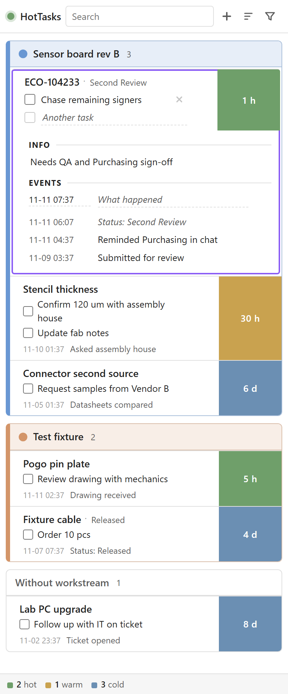

# HotTasks

An Obsidian task tracker plugin that tracks how long since you last made progress on a task.
Helps you spot what tasks to follow up on.

<picture>
  <source media="(prefers-color-scheme: dark)" srcset="docs/img/pane-dark.png">
  
</picture>

More info to follow.
